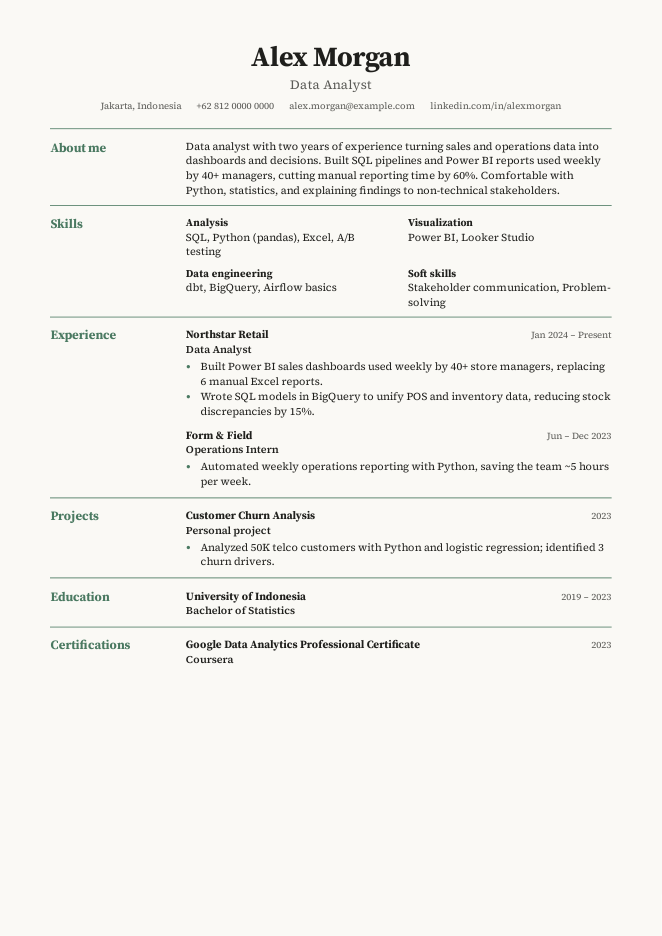
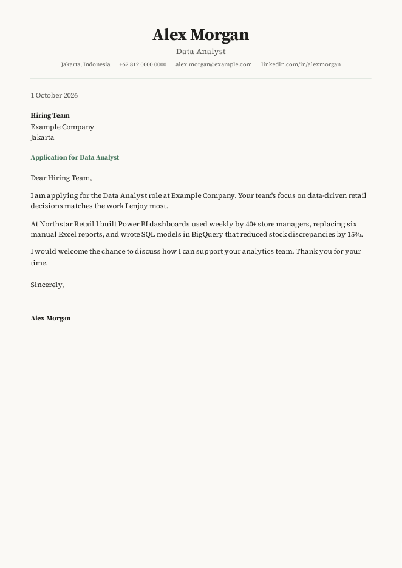

# CV Tailor

Asisten lamaran kerja berbasis AI. Kirim link atau teks lowongan, lalu kamu dapat:

- **Cek kecocokan**: fit score 0–100 dan saran *Lamar / Lamar dengan catatan / Pertimbangkan skip*
- **Laporan gap**: skill yang diminta lowongan tapi belum kamu punya, plus **rencana belajar** (kursus + mini-project)
- **CV yang disesuaikan** dengan keyword lowongan (ramah ATS), desain ala Reactive Resume "Bronzor"
- **Cover letter** dengan desain yang sama
- **Tracker lamaran** (Excel): perusahaan, posisi, skor, status, tanggal follow-up
- **Belum punya CV?** Kamu dipandu wawancara 7 langkah sampai CV jadi
- **Bahasa Indonesia atau English**, untuk obrolan maupun CV

**Prinsip utama:** isi CV hanya diambil dari data kamu sendiri. Skill atau pengalaman yang tidak kamu punya tidak akan
ditulis; semuanya masuk ke laporan gap.

| Contoh CV | Contoh cover letter |
|---|---|
|  |  |

*(Contoh memakai data fiktif.)*

---

## Daftar isi

1. [Pilih versi yang cocok](#1-pilih-versi-yang-cocok)
2. [Cara pasang](#2-cara-pasang), per platform
3. [Cara pakai](#3-cara-pakai)
4. [Menyimpan data antar sesi](#4-menyimpan-data-antar-sesi)
5. [Masalah umum](#5-masalah-umum)
6. [Privasi](#6-privasi)
7. [English quick start](#7-english-quick-start)
8. [Untuk kontributor](#8-untuk-kontributor)

---

## 1. Pilih versi yang cocok

| Kamu pakai… | Butuh akun berbayar? | PDF langsung jadi? | Tracker Excel | Panduan |
|---|---|---|---|---|
| **Claude.ai** (web / desktop / HP) | Tidak (Free bisa) | ✅ | ✅ | [2B](#2b-claudeai-web-desktop-hp) |
| **ChatGPT** (web / app) | Tidak (pakai Proyek) | ✅ | ✅ | [2C](#2c-chatgpt) |
| **Gemini** (web / app) | Tidak | ⚠️ Lewat "Save as PDF" di browser | ⚠️ Tempel ke Google Sheets | [2D](#2d-gemini-gem) |
| **Claude Code** (terminal) | Ya (Pro/Max atau API) | ✅ | ✅ | [2A](#2a-claude-code) |
| **Codex** (OpenAI) | Sesuai paket Codex | ✅ | ✅ | [2E](#2e-codex-antigravity-gemini-cli) |
| **Antigravity** (Google IDE) | Sesuai paket Antigravity | ✅ | ✅ | [2E](#2e-codex-antigravity-gemini-cli) |
| **Gemini CLI** | Sesuai paket Gemini CLI | ✅ | ✅ | [2E](#2e-codex-antigravity-gemini-cli) |

Bingung? Pakai **Claude.ai** atau **ChatGPT**: gratis, dan PDF-nya langsung jadi.

**Download** (klik file, lalu tombol *Download raw file*):

| File | Untuk |
|---|---|
| [`dist/cv-tailor-skill.zip`](dist/cv-tailor-skill.zip) | Claude.ai, Claude Code, Codex, Antigravity, Gemini CLI |
| [`dist/cv-tailor-chatgpt.zip`](dist/cv-tailor-chatgpt.zip) | ChatGPT |
| [`dist/cv-tailor-gemini.zip`](dist/cv-tailor-gemini.zip) | Gemini |

Atau download seluruh repo: tombol hijau **Code → Download ZIP**.

---

## 2. Cara pasang

### 2A. Claude Code

```bash
git clone https://github.com/fadiazahranzn/cv-tailor.git
mkdir -p ~/.claude/skills
cp -r cv-tailor/skill/cv-tailor ~/.claude/skills/
pip install jinja2 pymupdf openpyxl reportlab pypdf
```

Untuk PDF paling rapi, pakai Chrome atau Edge yang sudah terpasang (terdeteksi otomatis). Kalau tidak ada:
`npx playwright install chromium-headless-shell`. Tanpa browser pun PDF tetap jadi (pakai ReportLab).

Windows (PowerShell):
```powershell
git clone https://github.com/fadiazahranzn/cv-tailor.git
New-Item -ItemType Directory -Force $HOME\.claude\skills | Out-Null
Copy-Item -Recurse cv-tailor\skill\cv-tailor $HOME\.claude\skills\
pip install jinja2 pymupdf openpyxl reportlab pypdf
```

Cara pakai: ketik `/cv-tailor <link lowongan>`. Data kamu tersimpan permanen di `~/.cv-tailor/`.

### 2B. Claude.ai (web, desktop, HP)

1. Download [`dist/cv-tailor-skill.zip`](dist/cv-tailor-skill.zip).
2. Di claude.ai, pastikan **Code execution** aktif (biasanya di Settings → Capabilities).
3. Buka **Customize → Skills → + → Upload a skill**, lalu pilih `cv-tailor-skill.zip`.
4. Pastikan toggle skill **cv-tailor** menyala.
5. Buka chat baru dan tulis: *"Pakai skill cv-tailor ya, aku mau lamar lowongan ini: <link>"*.

### 2C. ChatGPT

Download dan ekstrak [`dist/cv-tailor-chatgpt.zip`](dist/cv-tailor-chatgpt.zip).

**Akun gratis: pakai Proyek**

1. Di sidebar ChatGPT klik **Proyek → Proyek baru**, beri nama `CV Tailor`.
2. Klik **"…"** di pojok kanan atas proyek → **Instruksi**. Buka `INSTRUKSI-PROYEK.txt` di Notepad,
   **Ctrl+A → Ctrl+C**, lalu tempel di kotak instruksi dan simpan.
3. Tab **Sumber → Tambahkan sumber**, lalu upload `cv-tailor-kit.zip` dan `knowledge/WORKFLOW.md`.
4. Mulai chat **di dalam proyek**, lalu ketik *"halo"*.

**Akun berbayar: Custom GPT** (bisa dibagikan ke orang lain)

1. **GPTs → + Create → Configure**, beri nama `CV Tailor`.
2. **Instructions:** tempel isi `INSTRUCTIONS.txt`.
3. **Knowledge:** upload semua file di folder `knowledge/`.
4. **Capabilities:** nyalakan **Code Interpreter & Data Analysis** dan **Web Search**.
5. **Create**.

Detail lengkap: [`chatgpt/SETUP.md`](chatgpt/SETUP.md).

### 2D. Gemini (Gem)

Download dan ekstrak [`dist/cv-tailor-gemini.zip`](dist/cv-tailor-gemini.zip).

1. Buka **gemini.google.com → Gem → + Gem Baru**. Jangan pilih "New Gem" dari *Labs*.
2. **Nama:** `CV Tailor`.
3. **Petunjuk:** buka `GEM_INSTRUCTIONS.txt` di Notepad, **Ctrl+A → Ctrl+C**, lalu tempel.
   Jangan klik tombol ✨ di bawah kotak, karena tombol itu menulis ulang instruksinya.
4. **Alat default:** pilih **Canvas**.
5. **Informasi:** klik **+** lalu upload `knowledge/WORKFLOW.md` dan `knowledge/cv-template.html`
   (kalau `.html` ditolak, pakai `cv-template.txt`).
   Opsional: upload CV kamu sendiri supaya tidak perlu upload tiap chat, **hanya** kalau Gem ini untuk dipakai sendiri.
6. **Simpan → Mulai Percakapan**.

Cara dapat PDF: CV muncul di Canvas, lalu klik **Save as PDF** (atau Ctrl+P) dan atur:
Destination **Save as PDF**, ✅ **Background graphics**, ❌ **Headers and footers**.
Kalau muncul sebagai kode, klik ikon **⬇ download**, buka file `.html`-nya di Chrome, lalu klik **Save as PDF**.

> Gemini lebih sering "menambah bumbu" (skill atau angka yang tidak ada di CV). **Selalu cek ulang isi CV sebelum dikirim.**

Detail lengkap: [`gemini/SETUP.md`](gemini/SETUP.md).

### 2E. Codex, Antigravity, Gemini CLI

Semuanya memakai format skill yang sama (`SKILL.md`). Copy folder `skill/cv-tailor` ke lokasi berikut:

| Tool | Lokasi folder |
|---|---|
| Codex | `~/.agents/skills/cv-tailor/` |
| Antigravity | `~/.gemini/antigravity/skills/cv-tailor/` (global) atau `<project>/.agents/skills/cv-tailor/` |
| Gemini CLI | `~/.gemini/skills/cv-tailor/` |

Contoh (Codex):
```bash
git clone https://github.com/fadiazahranzn/cv-tailor.git
mkdir -p ~/.agents/skills && cp -r cv-tailor/skill/cv-tailor ~/.agents/skills/
pip install jinja2 pymupdf openpyxl reportlab pypdf
```

Lalu minta ke agent-nya: *"pakai skill cv-tailor, sesuaikan CV aku untuk lowongan ini: <link>"*.
Di Windows gunakan `python` (bukan `python3`).

---

## 3. Cara pakai

### Alur

```
Mulai chat
   │
   ├─ "Bahasa / Language?" → Indonesia / English
   │
   ├─ "Kamu sudah punya CV?"
   │     ├─ Sudah   → upload PDF/DOCX (atau export PDF dari LinkedIn)
   │     └─ Belum   → wawancara 7 langkah → CV dibuatkan
   │
   ├─ Tempel link / teks lowongan
   │
   ├─ 1. Cek kecocokan  → tabel keyword ✅ 🟡 ❓ ❌ + fit score + saran
   ├─ 2. Konfirmasi     → "skill ini kamu punya?" (jawab jujur)
   ├─ 3. Rencana belajar untuk skill yang belum ada
   ├─ 4. Pilih bahasa CV → ikut lowongan / Indonesia / English / dua-duanya
   ├─ 5. CV + cover letter (PDF)
   ├─ 6. Dicatat di tracker
   │
   └─ 7. Kamu cek ulang → kirim lamaran
```

### Contoh pesan

| Kamu mau… | Ketik |
|---|---|
| Lamar lowongan | `aku mau lamar lowongan ini: <link>` (kalau link diblokir, paste teksnya) |
| Cek dulu cocok atau tidak | `cek cocok nggak aku sama lowongan ini: <link>` |
| Bikin CV dari nol | `aku belum punya CV, bantu bikin dong` |
| CV umum (tanpa lowongan) | `bikinin CV umum aja dulu` |
| Update status | `lamaran di <perusahaan> udah dipanggil interview` |
| Lihat semua lamaran | `udah ngelamar ke mana aja?` |
| Tambah skill baru | `aku udah selesai kursus SQL di Dicoding` |
| Ganti tampilan | `ganti warna ungu, font sans` |

### Wawancara 7 langkah (kalau belum punya CV)

1. **Target**: posisi, status (mahasiswa / fresh graduate / kerja / pindah bidang), bahasa CV
2. **Data diri**: nama, kota, HP, email, LinkedIn. Foto, tanggal lahir, agama, dan status nikah tidak ditanya.
3. **Pendidikan**: kampus, jurusan, tahun, IPK (ditulis kalau ≥ 3.00), skripsi
4. **Kerja / magang / part-time**: tugas dan hasilnya
5. **Organisasi / kepanitiaan / volunteer**
6. **Project, lomba, kursus, sertifikat**
7. **Skill & bahasa**: hanya yang ada buktinya

Semua langkah boleh di-skip. Di akhir, kamu melihat ringkasan dan setiap kalimat CV sebelum disimpan.

---

## 4. Menyimpan data antar sesi

| Platform | Cara menyimpan profil & tracker |
|---|---|
| Claude Code, Codex, Antigravity, Gemini CLI | Otomatis di `~/.cv-tailor/` |
| Claude.ai, ChatGPT | Di akhir chat, **download `cv-tailor-data.zip`**. Di chat berikutnya, **upload lagi** file itu. Simpan selalu versi terbaru. |
| Gemini | Upload CV (atau teks "PROFIL CV" dari Gemini, disimpan sebagai `profil.txt`) ke **Informasi** di Gem |

---

## 5. Masalah umum

| Masalah | Solusi |
|---|---|
| Link lowongan tidak terbaca (Glints, LinkedIn, JobStreet sering memblokir) | Copy-paste teks lowongan atau kirim screenshot |
| ChatGPT bilang `cv-tailor-kit.zip` tidak ditemukan | Upload `cv-tailor-kit.zip` langsung di chat |
| Gemini memberi kode HTML, bukan PDF | Klik ⬇ download → buka file di Chrome → **Save as PDF** |
| PDF tanpa warna latar / ada tanggal di pojok | Saat print: ✅ Background graphics, ❌ Headers and footers |
| CV berisi skill yang tidak kamu punya | Bilang: *"hapus X, tidak ada di profil aku"*. Selalu cek sebelum kirim. |
| Font berubah jadi Times/Helvetica | File font tidak ter-upload. CV tetap valid, hanya tampilannya berbeda. |
| `python3` tidak dikenal (Windows) | Pakai `python` |

---

## 6. Privasi

- Repo ini **tidak berisi data pribadi siapa pun**. Contoh CV memakai tokoh fiktif (Alex Morgan).
- Data kamu (profil, tracker) tersimpan di perangkatmu (`~/.cv-tailor/`) atau di file `cv-tailor-data.zip` milikmu.
- Kalau membagikan Gem, GPT, atau Proyek buatanmu, **jangan** sertakan CV pribadimu di Knowledge/Informasi/Sumber.
  Siapa pun yang memakai Gem/GPT itu bisa membacanya.

---

## 7. English quick start

CV Tailor is an AI job-application assistant: paste a job posting and get a fit score, a gap report with a learning
plan, a keyword-tailored CV and cover letter (Reactive Resume "Bronzor" style), and an Excel application tracker.
No CV yet? A 7-step guided interview builds one. Chat and CV can be in English or Indonesian. It never adds skills or
experience you don't have.

- **Claude.ai**: upload `dist/cv-tailor-skill.zip` in Customize → Skills (code execution on), then say
  "use the cv-tailor skill for this job: <link>".
- **ChatGPT (free)**: create a Project, paste `chatgpt/INSTRUKSI-PROYEK.txt` as instructions (it's in English), add
  `chatgpt/cv-tailor-kit.zip` and `chatgpt/knowledge/WORKFLOW.md` as sources, start a chat and pick *English*.
- **Gemini**: create a Gem, paste `gemini/GEM_INSTRUCTIONS.txt`, set default tool to Canvas, add
  `gemini/knowledge/WORKFLOW.md` and `cv-template.html`.
- **Claude Code / Codex / Antigravity / Gemini CLI**: copy `skill/cv-tailor` into the tool's skills folder (table in
  section 2E) and `pip install jinja2 pymupdf openpyxl reportlab pypdf`.

Pick **English** when asked "Bahasa / Language?".

---

## 8. Untuk kontributor

```
skill/cv-tailor/        skill utama (SKILL.md, scripts, template, font), sumber kebenaran
shared/WORKFLOW.md      aturan netral untuk ChatGPT & Gemini
shared/cv-template.html template HTML untuk Gemini
chatgpt/, gemini/       instruksi + knowledge (folder knowledge/ dibuat otomatis)
dist/                   ZIP siap download (dibuat otomatis)
tools/build.py          sinkronisasi + cek privasi + build ZIP
```

Setelah mengubah `skill/` atau `shared/`, jalankan:
```bash
python tools/build.py              # sync + cek privasi + dist/
python tools/build.py --previews   # juga render ulang gambar contoh di docs/
```

`build.py` gagal kalau menemukan email/nomor HP asli atau file data pribadi. Kamu juga bisa menambah istilah
pribadimu sendiri (nama, tempat kerja) di `tools/private_terms.txt`. File itu tidak ikut ter-commit.

## Lisensi

Kode dan dokumentasi: [MIT](LICENSE). Font Source Serif 4 dan Inter: SIL Open Font License 1.1
(`skill/cv-tailor/assets/fonts/OFL-*.txt`). Desain terinspirasi template "Bronzor" dari
[Reactive Resume](https://rxresu.me).
